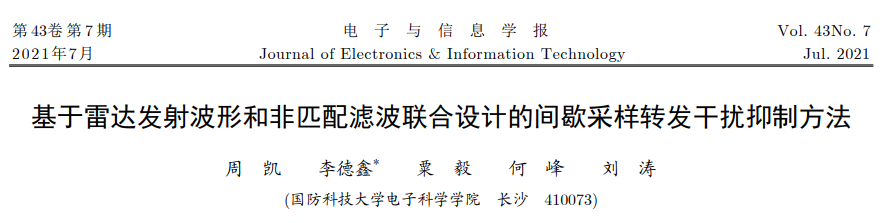
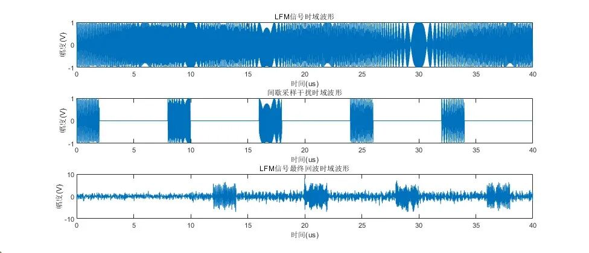
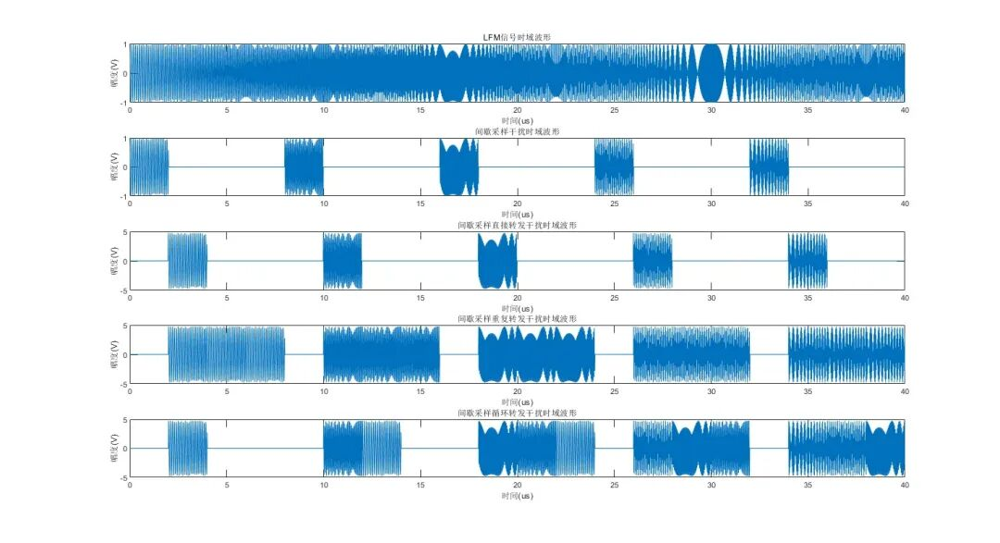
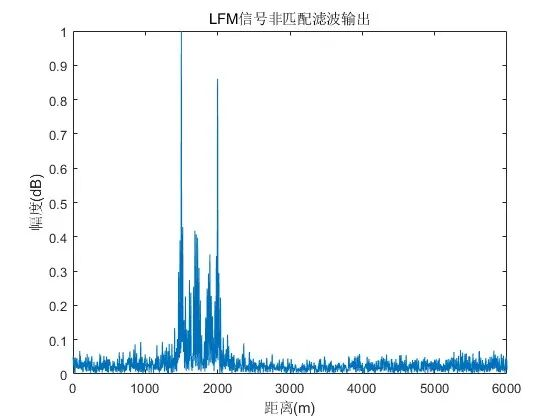
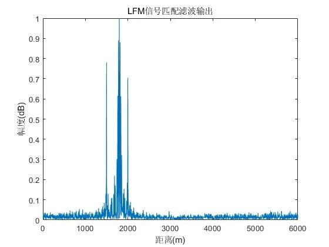
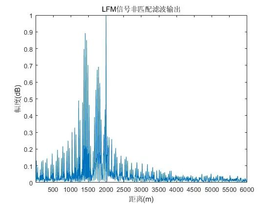

# [Anti-Interference] New Path for Radar Anti-ISRJ Interference: Design of Transmit Waveform and Non-Matched Filter in Detail [with MATLAB Code]

Personal Blog: https://www.cnblogs.com/EWFrontier  
Radar ISRJ Interference New Pathway: Design of Transmit Waveform and Non-Matched Filtering in Detail  
Introduction\tIn modern radar countermeasures, Intermittent Sampling Forwarding Interference (ISRJ) generates a dense cluster of pseudo targets through the principle of undersampling and digital radio frequency storage technology, severely disrupting radar's detection and recognition of real targets. Traditional anti-interference techniques either rely on complex segmented processing at the receiving end or are limited to single-waveform design, making it difficult to balance anti-interference effectiveness with signal processing efficiency. The team from National University of Defense Technology has proposed a "Joint Design of Radar Transmit Waveform and Non-Matched Filtering" method, providing an innovative solution to this problem. Its core logic and practical effects are highly educational for students in the field of interference suppression.  
1. ISRJ Interference: The "Pseudo Target Mystery" of Radar Detection  
ISRJ is a new type of coherent interference technique. Its working mechanism is very clever: by sampling small segments of the radar transmit signal intermittently, high fidelity forwarding is performed, forming a work mode of time-division sampling-forwarding alternating reception and transmission, ultimately constructing a large number of dense pseudo targets similar to real targets at the radar receiving end.  
The core threat of this interference lies in its ability to precisely utilize the characteristics of radar matching filtering, even low sidelobe traditional radar signals are hard to escape its interference. More importantly, ISRJ possesses real-time fast response capability, traditional filtering methods and parameter estimation methods that rely on time-frequency characteristic differences often have limited effectiveness, becoming a "hard bone" in the field of radar anti-interference.  
2. Core Pain Points of Existing Anti-Interference Methods Currently, there are mainly two approaches in the academic community to combat ISRJ, but both have obvious limitations:  
1  
Receiver-end signal processing method: By constructing multiple bandpass filters and time-frequency analysis to distinguish between targets and interference signals, but requires complex segmented processing of received signals, resulting in larger computational requirements and difficulty in ensuring real-time performance;  
2
Transmit end waveform design method: By designing sparse Doppler waveforms and intra-pulse orthogonal waveforms to disrupt interference continuity, while only focusing on the optimization of a single transmitter, it still requires the receiver's cooperation in segmented processing. This limits the design freedom and restricts the effectiveness of interference rejection.
How to break through the bottleneck of "single link design" and simplify the complexity of receiver end processing simultaneously has become a key breakthrough in anti-ISRJ technology.
III. Core Innovation: Dual-Link Joint Design for Anti-Interference Logic
The core idea of this paper is: instead of designing transmit waveforms or receiver filters independently, we aim to achieve dual goals of "signal performance improvement" and "active interference suppression" through the joint optimization of "transmit waveform + non-matching filter", while reducing the difficulty of receiver end processing.
1. Design objectives: The core of dual-optimization + hard constraints joint design is to construct a "multi-objective optimization model" that balances signal performance with anti-interference capability:
✧
Optimization objectives: On one hand, suppress the integral sidelobes of radar transmit signals after non-matching filtering (ensuring the clarity of real target detection), and on the other hand, suppress the integral energy of ISRJ interference after filtering (weakening the intensity of false targets);
✧
Constraint conditions: Considering the actual hardware of the radar, add amplitude constraints to the transmit signal (avoiding distortion of radio frequency and power amplifier components), and set thresholds for the main lobe peak and interference peak values (to ensure main lobe detection performance and limit zero delay position interference peak).
2. Implementation path: Since the optimization problem involves constant modulus waveform design (a non-convex NP-hard problem), the team adopts the approach of "problem decomposition + cyclic iteration", breaking down complex problems into two solvable sub-problems, with clear and straightforward steps:
1  
Initialization: Set initial values for transmit waveform, non-matching filter, and intermediate variables (such as random phase encoding sequences);
2  
Filter optimization: Fix the transmit waveform, solve for the optimal non-matching filter using analytical methods;
3  
Waveform optimization: Fix the filter, introduce an intermediate variable to transform the constant modulus constraint problem, update the transmit waveform through alternating direction multiplier method;
4
Iterative convergence: Alternately updating the intermediate and dual variables until the residual waveform error with respect to the intermediate variable meets preset conditions or reaches the maximum number of iterations.
3. Key design results are ultimately obtained through iterative algorithms:
✧  
Employing emission waveforms that satisfy constant modulus constraints (amplitude stability, adaptable to hardware requirements);
✧  
Designed non-matched filter for targeted purposes;
✧  
Core performance metrics: Signal integral sidelobe suppression down to -13.26 dB, interference integral energy suppression down to -16.07 dB, pulse compression peak sidelobe value as low as -34.66 dB, and signal processing gain loss only at -1.63 dB, balancing performance and efficiency.
IV. Simulation verification: To validate the effectiveness of the anti-interference design, the team conducted two sets of core simulation experiments, comparing traditional LFM (Linear Frequency Modulation) signals, highlighting the advantages of the joint design:
1. The suppression effects on different ISRJ styles for "direct forwarding," "repeat forwarding," and "circular forwarding" types of typical ISRJ interference were tested:
✧  
Traditional LFM signals (whether matched or not) would result in a large number of dense false targets, making interference ineffectively eliminated;
✧  
In this paper's jointly designed signal, the number of dense false targets significantly reduced, and the interference peak dropped below -30 dB, effectively suppressing all three types of interference styles.
2. Stability under different signal-to-interference ratios: In tests ranging from -20 dB to 20 dB in signal-to-interference ratio:
✧  
The interference peak for both the joint design method and LFM non-matched filter increased first and then stabilized afterward with increasing signal-to-interference ratio, but the former consistently had lower interference peaks across the entire range of signal-to-interference ratios;
✧  
When the signal-to-interference ratio exceeded a certain value, interference was mainly caused by sidelobes of the signal and white noise, yet the joint design still maintained superior anti-interference stability.
3. Summary of Core Advantages Compared to existing methods, the joint design solution achieves "three excellences": higher design freedom (dual-stage coordination), simpler receiver processing (no need for complex segmentation), and broader interference resistance (adaptable to various ISRJ styles).
5. Conclusion and Outlook The proposed method of transmitting waveforms and non-matched filtering joint design provides a fresh perspective on solving ISRJ interference issues—through "transmitter-receiver" dual-stage coordination optimization, it breaks through the limitations of single-stage design while balancing the effect of interference resistance with the complexity of signal processing. Simulation results fully prove that this method can effectively suppress various types of ISRJ interference, providing a practical solution for radar anti-interference technology.
For students in the field of interference suppression, the core inspiration of this research lies in the idea of "system-level joint optimization": facing complex interference, one should not be limited to the improvement of a single link but should start from the entire transmission link of signals, enhancing anti-interference robustness through multi-objective collaborative design. Next steps will focus on studying the impact of key parameters of ISRJ (such as duty cycle, period) on the performance of the method, further improving the design scheme.
Conclusion Against the backdrop of rapid development in radar countermeasure technology, the suppression of new types of interference such as ISRJ has always been a hot topic and difficulty in research. This joint design method not only provides specific technical solutions but also conveys the scientific research idea of "problem decomposition-collaborative optimization-simulation verification", providing theoretical depth and practical value for learning for students in related directions and injecting new momentum into the innovation and development of anti-interference technology.
★

## Images

<!-- PAYMENT_BLOCK -->

## Get this dataset

- Payment link (Stripe): [Buy now](https://buy.stripe.com/3cs8yP7sY87d0vu9AB)
- Payment QR code: 

<!-- /PAYMENT_BLOCK -->
